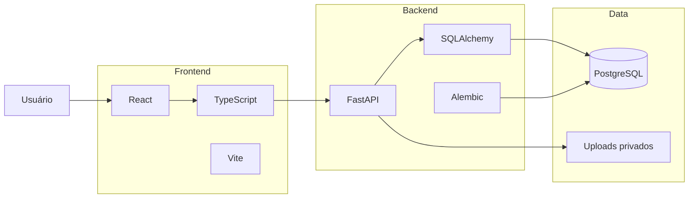

<div align="center">


# Matcha Planner

### your little digital corner for plans, studies & slow productivity

**Um planner digital full stack criado para transformar organização em uma experiência visual, pessoal e acolhedora.**

React · TypeScript · FastAPI · PostgreSQL

<br>

`PLAN`　`FOCUS`　`STUDY`　`CREATE`　`BREATHE`

---

</div>

## 𓂃 Sobre o Matcha

O **Matcha Planner** nasceu da ideia de que produtividade não precisa parecer uma planilha corporativa cinza.

Ele é um ambiente digital para reunir rotina, estudos, tarefas, projetos, calendário, hábitos, reflexões e planejamento em uma experiência que mistura:

- organização;
- personalização;
- papelaria digital;
- interfaces inspiradas em desktop;
- planners físicos;
- pequenos elementos lúdicos;
- dados reais e persistentes.

Por trás da estética delicada existe uma aplicação **full stack completa**, com autenticação, banco de dados relacional, API própria, persistência, segurança, uploads privados, analytics e diferentes módulos conectados entre si.

> **Matcha Planner é um planner para organizar a vida sem tirar dela a personalidade.**

---

## ✦ Conceito visual

A identidade do Matcha combina tons suaves, verde matcha, papéis claros, recibos, pequenas janelas de desktop e elementos inspirados em planners físicos.

Cada área possui sua própria personalidade visual, mas todas pertencem ao mesmo universo.

```text
            MATCHA PLANNER
                  │
        ┌─────────┴─────────┐
        │                   │
    organização         experiência
        │                   │
 tarefas · agenda      papel · stickers
 estudos · dados       janelas · cores
 calendário · foco     detalhes · calma
```

A proposta não foi criar apenas um dashboard.

A proposta foi criar **um lugar digital em que dá vontade de voltar**.

---

# 𓂃 Principais áreas

## Hoje

Uma visão resumida do dia para reduzir a quantidade de lugares que o usuário precisa consultar.

Reúne informações importantes da rotina e funciona como ponto de entrada para o planejamento diário.

---

## Agenda

O coração criativo do Matcha.

A Agenda funciona como um editor visual de páginas e permite trabalhar com diferentes estruturas de planejamento.

Entre os recursos estão:

- páginas e agendas;
- templates;
- elementos livres;
- textos;
- imagens;
- stickers;
- biblioteca reutilizável de mídia;
- movimentação e redimensionamento de elementos;
- rotação;
- camadas;
- undo/redo;
- diferentes tipos de papel;
- modo de visualização;
- tema claro e escuro;
- templates semanais;
- widgets conectados a dados reais do planner.

### Weekly Open Journal

Um dos layouts especiais da Agenda.

Ele transforma duas páginas em um diário semanal aberto, reunindo:

- dias da semana;
- tarefas reais;
- hábitos;
- humor;
- hidratação;
- prioridades;
- reflexão semanal;
- navegação entre semanas.

Os dados não são apenas decorativos: eles são carregados e persistidos pelo backend.

---

## Tarefas

Gerenciamento de tarefas conectado ao restante do sistema.

As tarefas podem participar de diferentes visualizações do Matcha e alimentar módulos como Agenda e Calendário.

A interface foi inspirada em um pequeno **recibo físico**, reforçando a identidade visual do projeto.

---

## Inbox

Um lugar para registrar rapidamente ideias e pendências antes de decidir onde elas realmente pertencem.

Os itens podem posteriormente ser transformados em entidades organizadas do planner.

---

## Calendário

Visualização temporal de eventos e tarefas.

Inclui:

- eventos;
- datas;
- lembretes;
- tarefas exibidas no calendário;
- associação com matérias;
- elementos visuais e stickers reutilizáveis.

---

## Estudos

Área dedicada ao acompanhamento das sessões de estudo.

Permite registrar:

- matéria;
- assunto;
- data;
- duração;
- observações.

A partir desses dados o Matcha calcula visualizações como:

- histórico;
- distribuição de estudos;
- horas estudadas;
- últimos dias;
- sequência de estudos.

---

## Prazos

Uma visão dedicada a deadlines importantes.

Ajuda a separar prazos reais de tarefas comuns e facilita a visualização das próximas entregas.

---

## Revisão semanal

Um espaço para olhar para a semana como um todo.

Permite registrar prioridades, objetivos e reflexões que também podem aparecer em outras experiências do planner.

---

## Organização

Área voltada à estrutura interna do usuário, incluindo entidades utilizadas para organizar outras partes do sistema, como projetos, matérias e categorias.

---

## Dados

O Matcha também possui uma camada de analytics.

Os dados registrados no planner podem ser utilizados para gerar métricas sobre o uso e a rotina do usuário.

O projeto também possui sistema de exportação de dados para backup.

---

## Perfil e conta

Inclui gerenciamento das informações do usuário e recursos relacionados à própria conta.

A autenticação foi desenvolvida no backend do projeto e não depende de um serviço externo de login.

---

# ✦ Stickers & fotos

A antiga ideia de uma página separada de papelaria foi removida da interface.

Stickers e fotos continuam fazendo parte do projeto, mas vivem onde realmente são úteis:

**dentro da Agenda.**

A biblioteca de mídia permite reutilizar arquivos em diferentes páginas sem transformar a aplicação em um catálogo separado de elementos decorativos.

Também existe suporte para criação e recorte de stickers a partir de imagens.

---

# 𓂃 Arquitetura



O projeto é dividido principalmente em:

```text
planner-digital/
│
├── frontend/
│   ├── src/
│   │   ├── components/
│   │   ├── pages/
│   │   └── services/
│   └── public/
│
├── backend/
│   ├── app/
│   │   ├── routes/
│   │   ├── models
│   │   ├── schemas
│   │   ├── security
│   │   └── database
│   │
│   ├── alembic/
│   └── requirements.txt
│
└── README.md
```

---

# ✦ Stack

### Frontend

| Tecnologia | Uso |
|---|---|
| React 19 | Interface |
| TypeScript | Tipagem e desenvolvimento |
| Vite | Build e ambiente de desenvolvimento |
| React Router | Navegação |
| dnd-kit | Drag and drop |
| Lucide React | Iconografia |
| CSS | Design system e interfaces |

### Backend

| Tecnologia | Uso |
|---|---|
| Python | Linguagem principal |
| FastAPI | API |
| SQLAlchemy | ORM |
| Alembic | Migrations |
| PostgreSQL | Banco relacional |
| Psycopg | Driver PostgreSQL |
| Pydantic | Validação |
| Uvicorn | Servidor ASGI |

---

# 𓂃 Segurança

Apesar da estética leve, a segurança foi tratada como parte da arquitetura do projeto.

O Matcha utiliza:

- senhas armazenadas com hash;
- autenticação baseada em sessão/JWT;
- cookie de autenticação `HttpOnly`;
- proteção CSRF;
- sessões revogáveis;
- rate limiting em autenticação;
- validação de ownership;
- proteção de uploads;
- CORS configurável;
- headers de segurança;
- configuração específica para produção;
- proteção do fluxo de Web Push;
- validação de endpoints externos;
- isolamento dos dados entre usuários.

Em produção, documentação interna da API e endpoints de diagnóstico adicionais são desativados.

---

# ✦ Banco de dados

O PostgreSQL é utilizado como fonte persistente de dados.

A aplicação possui entidades relacionadas a áreas como:

```text
Usuários
│
├── Agendas
│   ├── Páginas
│   ├── Blocos
│   ├── Elementos de canvas
│   └── Mídias
│
├── Tarefas
├── Eventos
├── Estudos
├── Hábitos
├── Projetos
├── Matérias
├── Categorias
├── Inbox
├── Revisões semanais
├── Entradas diárias
└── Lembretes
```

As alterações estruturais do banco são controladas com **Alembic migrations**.

---

# 𓂃 Autenticação

O fluxo de autenticação é controlado pelo próprio backend.

Após o login:

```text
login
  ↓
validação da senha
  ↓
criação da sessão
  ↓
token associado à sessão
  ↓
cookie HttpOnly
  ↓
requisições autenticadas
```

O JWT não precisa ficar disponível ao JavaScript do navegador.

---

# ✦ Executando localmente

## Requisitos

Tenha instalado:

- Python 3.13;
- Node.js 22.18+ ou versão compatível mais recente;
- PostgreSQL.

---

## 1. Backend

Entre na pasta:

```powershell
cd backend
```

Crie o ambiente virtual:

```powershell
python -m venv .venv
```

Instale as dependências:

```powershell
.venv\Scripts\python.exe -m pip install -r requirements.txt
```

Crie seu arquivo de ambiente:

```powershell
Copy-Item .env.example .env
```

Configure as credenciais do PostgreSQL e gere um `JWT_SECRET` próprio.

Depois aplique as migrations:

```powershell
.venv\Scripts\python.exe -m alembic upgrade head
```

Inicie a API:

```powershell
.venv\Scripts\python.exe -m uvicorn app.main:app --host 127.0.0.1 --port 8000
```

Em desenvolvimento, a API estará disponível em:

```text
http://127.0.0.1:8000
```

---

## 2. Frontend

Em outro terminal:

```powershell
cd frontend
```

Instale as dependências:

```powershell
npm ci
```

Crie o ambiente:

```powershell
Copy-Item .env.example .env
```

Inicie:

```powershell
npm run dev
```

Por padrão:

```text
http://localhost:5173
```

---

# ✦ PostgreSQL no Windows

O serviço utilizado no ambiente atual é:

```text
postgresql-x64-18
```

Para iniciá-lo no PowerShell como administrador:

```powershell
Get-Service postgresql-x64-18
Start-Service postgresql-x64-18
Get-Service postgresql-x64-18
```

Para verificar a porta:

```powershell
Test-NetConnection 127.0.0.1 -Port 5432
```

O resultado esperado é:

```text
TcpTestSucceeded : True
```

---

# 𓂃 Variáveis de ambiente

Nunca versione credenciais reais.

### Backend

Utilize:

```text
backend/.env.example
```

Como base para configurar:

```env
DB_HOST=
DB_PORT=
DB_NAME=
DB_USER=
DB_PASSWORD=

JWT_SECRET=
JWT_ALGORITHM=HS256
JWT_EXPIRATION_MINUTES=1440

APP_ENV=
CORS_ORIGINS=

COOKIE_SECURE=
COOKIE_SAMESITE=

VAPID_PUBLIC_KEY=
VAPID_PRIVATE_KEY_PATH=
VAPID_SUBJECT=
```

### Frontend

```text
frontend/.env.example
```

Exemplo:

```env
VITE_API_URL=http://127.0.0.1:8000
```

Variáveis `VITE_*` são incorporadas ao build e **não devem guardar secrets**.

---

# ✦ Validação

## Frontend

```powershell
npm run lint
npm run build
```

Testes das partes principais do editor:

```powershell
node --test tests/planning.test.mjs tests/templateEditing.test.mjs tests/canvasGeometry.test.mjs
```

---

## Backend

```powershell
.venv\Scripts\python.exe -m compileall app
.venv\Scripts\python.exe -m pip check
```

Testes de segurança:

```powershell
.venv\Scripts\python.exe -B -m unittest test_account_upload_ownership test_push_security test_auth_hardening
```

Testes adicionais:

```powershell
.venv\Scripts\python.exe -B test_academic_inbox.py
.venv\Scripts\python.exe -B test_release_security.py
```

Alguns testes criam schemas PostgreSQL temporários e exigem permissão para criação de schema.

Não execute scripts antigos configurados com URLs fixas contra bancos contendo dados reais.

---

# 𓂃 API

Em desenvolvimento, o FastAPI disponibiliza documentação automática.

```text
/docs
/redoc
```

Também existem endpoints de diagnóstico:

```text
/health
/db-health
```

`/db-health` e a documentação da API são desativados em produção quando apropriado.

---

# ✦ Backup

O projeto possui estrutura de exportação de dados para permitir backup das principais informações do planner.

Dados sensíveis de autenticação não devem fazer parte de exportações de usuário.

Para ambientes reais, o backup do PostgreSQL deve ser acompanhado do backup do armazenamento de uploads.

---

# 𓂃 Produção

A V1 está funcional localmente.

A hospedagem definitiva ainda não foi definida.

Antes de colocar o Matcha em produção:

```text
[ ] banco PostgreSQL persistente
[ ] HTTPS
[ ] JWT_SECRET forte
[ ] APP_ENV=production
[ ] COOKIE_SECURE=true
[ ] CORS_ORIGINS configurado
[ ] VITE_API_URL configurado
[ ] alembic upgrade head
[ ] uploads persistentes
[ ] backup do banco
[ ] backup dos arquivos
[ ] smoke test da aplicação publicada
```

O backend deve ser iniciado sem `--reload`.

Os uploads não devem ser expostos como uma pasta pública do servidor; o projeto utiliza rotas autenticadas para acesso aos arquivos privados.

---

# ✦ Status

```text
MATCHA PLANNER
────────────────────────────────

Product design          ✓
Frontend                ✓
Backend                 ✓
PostgreSQL              ✓
Autenticação            ✓
Agenda                  ✓
Tarefas                 ✓
Calendário              ✓
Estudos                 ✓
Inbox                    ✓
Planejamento semanal    ✓
Analytics               ✓
Uploads                  ✓
Segurança               ✓
Testes principais       ✓

Deploy público           ◌
```

### V1 — funcional e pronta para preparação de produção.

Novas funcionalidades e melhorias visuais ficam para versões posteriores.

---

# 𓂃 Filosofia do projeto

O Matcha Planner foi desenvolvido com uma ideia simples:

> **um software pode ser tecnicamente sólido sem precisar parecer frio.**

Arquitetura, banco de dados, segurança e regras de negócio convivem com papel, cores suaves, stickers, pequenas janelas e detalhes que fazem a aplicação parecer um espaço pessoal.

O objetivo não é apenas marcar tarefas como concluídas.

É tornar o processo de organizar a própria vida um pouco mais agradável.

---

<div align="center">

### Matcha Planner

`a little place for big plans.`

<br>

**Designed & developed by Giovanna Duarte**

</div>
